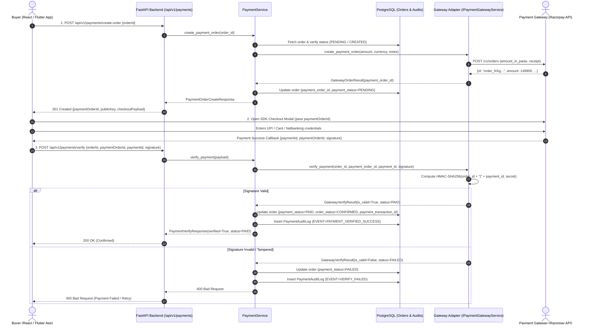
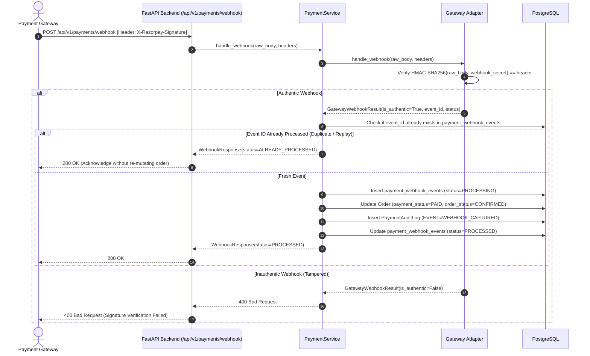

# KALA-MITRA — Order & Payment Flow Specification

This document details the lifecycle, sequence interactions, and state machines governing orders and payments in KALA-MITRA.

---

## 1. End-to-End Payment Sequence Flow



---

## 2. Server-to-Server Webhook Flow & Idempotency

When a payment succeeds or fails asynchronously (or if the user's browser closes before verification), the gateway sends a direct webhook to FastAPI.



---

## 3. OrderStatus vs. PaymentStatus State Machines

> [!IMPORTANT]
> `OrderStatus` and `PaymentStatus` are strictly independent fields. An order can only proceed to physical processing (`PROCESSING`, `SHIPPED`, `DELIVERED`) once `PaymentStatus` is `PAID`.

```
           OrderStatus                             PaymentStatus
       ┌─────────────────┐                      ┌─────────────────┐
       │     CREATED     │                      │     PENDING     │
       └────────┬────────┘                      └────────┬────────┘
                │                                        │
      (Checkout Initiated)                    (Payment Attempted)
                │                                        │
                ▼                                        ▼
       ┌─────────────────┐                      ┌─────────────────┐
       │     PENDING     │                      │   AUTHORIZED    │
       └────────┬────────┘                      └────────┬────────┘
                │                                        │
     (Payment Verified PAID)                   (Signature Verified)
                │                                        │
                ▼                                        ▼
       ┌─────────────────┐                      ┌─────────────────┐
       │    CONFIRMED    │◄─────────────────────┤      PAID       │
       └────────┬────────┘                      └────────┬────────┘
                │                                        │
       (Artisan Packaging)                           (Refunded)
                │                                        │
                ▼                                        ▼
       ┌─────────────────┐                      ┌─────────────────┐
       │   PROCESSING    │                      │    REFUNDED     │
       └────────┬────────┘                      └─────────────────┘
                │
         (Dispatched)
                │
                ▼
       ┌─────────────────┐
       │     SHIPPED     │
       └────────┬────────┘
                │
          (Delivered)
                │
                ▼
       ┌─────────────────┐
       │    DELIVERED    │
       └─────────────────┘
```

---

## 4. Refund Lifecycle
1. Admin or authorized buyer requests cancellation on a `PAID` order.
2. Server verifies `order.payment_status == PAID` and extracts `payment_transaction_id`.
3. Gateway Adapter calls `POST /v1/payments/{payment_id}/refund`.
4. Upon successful gateway response:
   - `order.payment_status` becomes `REFUNDED`
   - `order.order_status` becomes `CANCELLED`
   - `payment_transactions` record is updated with `refund_id` and `amount_refunded`.
